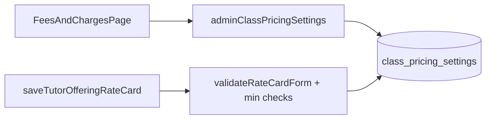

# Class pricing rules and platform fees (admin)

## Context

- Tutors set **online and offline** pricing via the rate card (base rate + discount % for 1–4, 5–10, and 11+ classes) saved through [`TutorRateCardService.saveForTutorUser`](apps/api/src/app/modules/tutor-rate-card/services/tutor-rate-card.service.ts) and validated in [`validateRateCardForm`](libs/shared-utils/src/rate-card.ts).
- Per-class price for a quantity uses shared logic in [`rateForModeAndQuantity`](libs/shared-utils/src/tutor-search.ts) + `discountForQuantity` (same rules as cart repricing).
- Admin **Fees & Charges** today only edits [`PlatformFeeConfig`](apps/api/src/app/modules/platform-fee/entities/platform-fee-config.entity.ts) rows. Minimum prices and commission are **not** platform fees — use a **singleton settings row** (same pattern as [`RegistrationSettingsEntity`](apps/api/src/app/modules/registration-settings/entities/registration-settings.entity.ts)).

## Data model

New table `class_pricing_settings` (singleton `id = 1`):

| Column | Type | Notes |
|--------|------|--------|
| `minimum_online_price_per_class_inr` | smallint | Floor for online; `0` = no extra floor beyond existing “base rate ≥ ₹1” |
| `minimum_offline_price_per_class_inr` | smallint | Floor for offline; same `0` semantics |
| `commission_slab_threshold_inr` | smallint | Price boundary for commission slabs; seed **600** |
| `tutor_commission_percent_up_to_slab` | smallint | `0–100`; commission when effective per-class rate **≤ threshold** (≤ ₹600 at default) |
| `tutor_commission_percent_above_slab` | smallint | `0–100`; commission when effective per-class rate **> threshold** |
| `platform_fee_per_participant_inr` | smallint | Flat INR platform fee **per participant** per class session; `0` = none; **stored only** (checkout/settlement later) |

Migration seeds row `id = 1`: minimums and commission percents `0`, `commission_slab_threshold_inr` **600**, platform fee `0`. Register entity in [`database.config.ts`](apps/api/src/app/database/database.config.ts).

## Backend module

New module e.g. `apps/api/src/app/modules/class-pricing-settings/`:

- **Entity** + GraphQL `@ObjectType` with the fields above.
- **Service**: `getSettings()`, `updateSettings(input)` with validation (minimums, threshold, and platform fee per participant `>= 0`; both commission percents `0–100`; threshold `>= 1`), `onModuleInit` + `ensureSingleton()` like registration settings.
- **Admin API** ([`admin.resolver.ts`](apps/api/src/app/modules/admin/admin.resolver.ts) / [`admin.service.ts`](apps/api/src/app/modules/admin/admin.service.ts)):
  - Query `adminClassPricingSettings`
  - Mutation `adminUpdateClassPricingSettings(input)`
- **Tutor/client read API**:
  - Query `classPricingSettings` — read-only same fields (rate-card UI + future commission display).

Shared GraphQL: add query/mutation documents under [`libs/shared-graphql`](libs/shared-graphql) (mirror [`registration-settings.queries.ts`](libs/shared-graphql/src/queries/registration-settings.queries.ts)).

## Minimum price enforcement (save time only)

**Rule (per mode):** When that delivery mode is enabled on the rate card and the admin minimum for that mode is `> 0`, the **lowest effective per-class rate** across bulk slabs must be `>=` the minimum. Lowest rate = min of `rateForModeAndQuantity(normalized, mode, qty)` for `qty ∈ {1, 5, 11}`.

Add in **shared-utils** (reuse [`rateForModeAndQuantity`](libs/shared-utils/src/tutor-search.ts)):

```typescript
function lowestPerClassRateInr(
  values: RateCardFormValues,
  mode: 'online' | 'offline',
): number | null;

function validateRateCardMinimumPrices(
  normalized: RateCardFormValues,
  floors: {
    onlineMinimumPricePerClassInr?: number;
    offlineMinimumPricePerClassInr?: number;
  },
): { ok: true } | { ok: false; message: string };
```

Error messages (one failure at a time, mode-specific), e.g. `Offline: effective price cannot be below ₹{min} per class (your lowest rate is ₹{lowest}).`

Wire enforcement:

1. **API** — In `TutorRateCardService.saveForTutorUser`, after `validateRateCardForm`, load settings and run `validateRateCardMinimumPrices`.
2. **UI** — Extend `validateRateCardForm` with optional floors in an options bag so [`RateCardModal.tsx`](libs/tutor-detail-ui/src/RateCardModal.tsx) matches API behavior. Fetch `classPricingSettings` where the modal is used (web + mobile).

**Out of scope:** backfill or block existing rate cards below a newly raised minimum until the tutor edits the card.

## Commission slabs and platform fee per participant

**Commission (two slabs, stored only in this task):**

| Effective per-class rate (INR) | Field used |
|-------------------------------|------------|
| ≤ `commissionSlabThresholdInr` (default **600**) | `tutorCommissionPercentUpToSlab` |
| > threshold | `tutorCommissionPercentAboveSlab` |

When payout is implemented (follow-up), slab choice uses the **effective per-class rate** for that booking (same notion as cart `unitRateInr` / `rateForModeAndQuantity` at purchase quantity)—not the tutor’s list base rate alone.

Add a small **shared-utils** helper (for future billing; unit-tested now):

```typescript
function tutorCommissionPercentForClassRate(
  effectivePerClassRateInr: number,
  settings: {
    commissionSlabThresholdInr: number;
    tutorCommissionPercentUpToSlab: number;
    tutorCommissionPercentAboveSlab: number;
  },
): number;
```

**Platform fee per participant:** persist `platformFeePerParticipantInr` via admin mutation only. **Per participant** = one student in a class session; billing model in follow-up.

No checkout, cart, or payout changes in this task.

## Admin UI

Extend [`FeesAndChargesPage.tsx`](apps/web-admin/src/app/pages/FeesAndChargesPage.tsx):

- Keep existing platform-fee table.
- Add section **“Class pricing”** below it:
  - Minimum online class price (INR)
  - Minimum offline class price (INR)
  - Commission slab threshold (INR), default **600**
  - Tutor commission % for class rate **up to** threshold (≤ ₹600 when threshold is 600)
  - Tutor commission % for class rate **above** threshold
  - Platform fee per participant (INR)
- Helper text: minimums apply to the **lowest** discounted per-class rate including bulk slabs; commission slabs and per-participant fee are applied in billing later based on each booking’s effective per-class rate.
- Load `adminClassPricingSettings`; save via `adminUpdateClassPricingSettings`.
- Update page subtitle to mention class pricing rules.



## Tests

- **shared-utils**: `lowestPerClassRateInr` / `validateRateCardMinimumPrices` for online and offline — base-only, slab2/slab3 lower, minimum `0` skipped, failure when lowest &lt; min.
- **shared-utils**: `tutorCommissionPercentForClassRate` at 600, 601, and custom threshold.
- **API**: `ClassPricingSettingsService` validation; `TutorRateCardService` rejects online and offline cards below configured minimums (mock settings).
- Extend [`tutor-rate-card.service.spec.ts`](apps/api/src/app/modules/tutor-rate-card/services/tutor-rate-card.service.spec.ts) as needed.

## Jira

After plan approval: create **TUTORIX** issue from this plan per repo Jira sync rules.

## Follow-ups (not in this task)

- Apply slabbed commission (`tutorCommissionPercentForClassRate`) and `platformFeePerParticipantInr` in cart/checkout and tutor payout when booking or class completes.
- Admin audit/history for settings changes.

## Implementation todos

1. **db-entity** — Migration + `ClassPricingSettings` entity/service (singleton) and module registration
2. **graphql-admin-public** — Admin + public GraphQL queries/mutations and shared-graphql documents
3. **min-price-validation** — shared-utils lowest-rate + `validateRateCardMinimumPrices` (online + offline); wire API + RateCardModal
4. **admin-ui** — Fees & Charges page — Class pricing section with save
5. **tests** — Unit tests for validation and rate-card save guards
