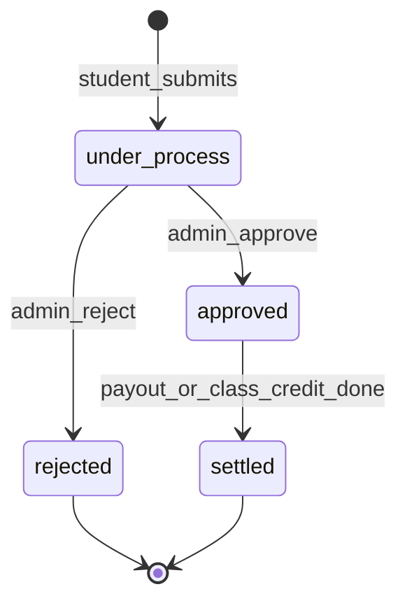
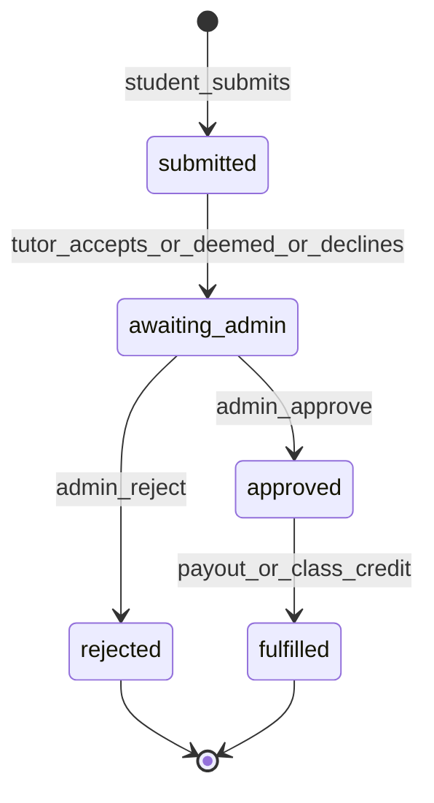

# Post-class refund claim

## Product rules (confirmed)

| Rule | Implementation |
|------|----------------|
| Eligibility | Class **ended** (`scheduledClassHasEnded`) and `now` is **before** IST end-of-next-calendar-day after class end (class ends 4pm Tue → claim/tutor deadline through **Wed 23:59:59 IST**) |
| Reasons | `class_did_not_take_place`, `technical_issue`, `not_satisfied` |
| Refund modes | `gateway`, `wallet`, `class_credit` (same tutor) — **`class_credit` disabled when reason is `not_satisfied`** |
| Tutor decline | **Advisory only**; claim stays in admin queue |
| Tutor silence by deadline | **`deemed_accepted`**; admin must still click **Approve** to pay out |
| Demo classes | Exclude (mirror cancellation: demos not refundable) |
| One claim per enrollment | Unique index on `enrollment_id` (active rows) |

## Student-visible status on concluded class card

After a student raises a claim, the **concluded class card** (web + mobile) shows a status line instead of the **Claim refund** button. Labels are fixed copy:

| Student label | When it applies |
|---------------|-----------------|
| **Under process** | Claim submitted and **admin has not decided yet** (`admin_status = pending`). Includes waiting on tutor response / deemed-accept cron. |
| **Approved** | **Admin approved** (`admin_status = approved`) but fulfillment is **not finished** (no `fulfilled_at`, and for cash/wallet linked `class_cancellation_refund_request.payout_status` is not `completed`). |
| **Rejected** | **Admin rejected** (`admin_status = rejected`). |
| **Settled** | Fulfillment **complete**: `fulfilled_at` set, **or** (gateway/wallet) linked cancellation refund request `payout_status = completed`. Class-credit path: credit restored to `unscheduled` and `fulfilled_at` set on approve. |

**UI rules**

- Show status on the card for the matching `enrollmentId` only (one claim per class).
- Use a compact badge or secondary line under tutor name (e.g. “Refund claim: Under process”).
- **Claim refund** button: only when eligible **and** no claim row exists for that enrollment.
- Optional: subtle color per status (amber = under process, blue = approved, red = rejected, green = settled) — match existing app badge patterns.
- Status persists after the **claim submission window** closes (student can still see outcome on old concluded classes).

**API / GraphQL**

- Expose `postClassRefundClaimStudentStatus: PostClassRefundClaimStudentStatus` on `StudentBookedClassSession` (nullable when no claim).
- GraphQL enum `PostClassRefundClaimStudentStatus`: `under_process`, `approved`, `rejected`, `settled`.
- Compute in API via `PostClassRefundClaimService.toStudentDisplayStatus(claim)` (single source of truth; do not duplicate mapping in clients).
- Include fields on `STUDENT_BOOKED_CLASS_SESSIONS` query in [`libs/shared-graphql`](libs/shared-graphql/src/queries/tutor-class-session.queries.ts).

## Architecture (separate from pre-class cancellation AI refunds)

Pre-class flows use [`class_cancellation_refund_request`](apps/api/src/app/modules/student-cart/entities/class-cancellation-refund-request.entity.ts) + AI batch. Post-class claims need their own entity and admin UI so we do not mix lifecycles.

**Internal workflow** (admin/tutor; not shown verbatim to student):

**Tutor response cron** (new job under [`apps/api/src/app/batch-jobs/`](apps/api/src/app/batch-jobs/)): nightly (or hourly) find claims where `tutor_response_status = pending` and `tutor_response_deadline_at <= now()` → set `tutor_response_status = deemed_accepted`, move to `awaiting_admin` (student status stays **Under process** until admin acts).

## Time helpers — [`libs/shared-utils`](libs/shared-utils/src/student-booking.ts)

Add (with unit tests):

- `classEndedAtUtc(startsAt, durationMinutes)`
- `postClassRefundClaimDeadlineUtc(...)` — IST midnight at end of **calendar day after** class-end day (exclusive upper bound for `now < deadline`)
- `canSubmitPostClassRefundClaim(...)` / `formatPostClassRefundDeadlineIst(...)` for UI copy

Reuse `toIstParts` / `istDayStartUtc` from [`libs/shared-utils/src/tutor-calendar.ts`](libs/shared-utils/src/tutor-calendar.ts).

## Data model (API migration + TypeORM)

New table `post_class_refund_claim`:

- **FKs**: `enrollment_id`, `class_credit_id`, `student_id`, `tutor_id`, `tutor_offering_id`, `order_item_id` (denormalized for admin list)
- **Snapshot**: `class_starts_at`, `duration_minutes`, `delivery_mode`, `offering_label`
- **Claim**: `reason` enum, `refund_method` enum (`gateway` \| `wallet` \| `class_credit`)
- **Amounts**: `preview_amount_inr`, `refund_breakdown_json` (same shape as cancellation snapshots)
- **Tutor**: `tutor_response_status` (`pending` \| `accepted` \| `declined` \| `deemed_accepted`), `tutor_decline_comment`, `tutor_responded_at`
- **Admin**: `admin_status` (`pending` \| `approved` \| `rejected`), `admin_comment`, `processed_by_user_id`, `processed_at`
- **Fulfillment**: `cancellation_refund_request_id` (nullable — links to existing payout row when money moves), `fulfilled_at`
- **Deadlines**: `tutor_response_deadline_at` (= student claim deadline), `submitted_at`

Register enums in GraphQL; wire entity in [`database.config.ts`](apps/api/src/app/database/database.config.ts) and [`student-cart.module.ts`](apps/api/src/app/modules/student-cart/student-cart.module.ts) (or a small sibling module imported there).

## Backend services

**`PostClassRefundClaimService`** (new, colocated with student-cart):

1. **`resolveCreditForEnrollment(studentId, enrollmentId)`** — load credit + relations (same joins as cancellation service).
2. **`assertClaimable(credit)`** — concluded, not demo, not cancelled, no existing claim, within deadline.
3. **`previewClaim(enrollmentId)`** — call refactored **`refundAmountsByCreditId`** from [`class-credit-cancellation.service.ts`](apps/api/src/app/modules/student-cart/services/class-credit-cancellation.service.ts) for a **single** concluded scheduled credit.
4. **`submitClaim`** — validate reason/method rules; persist claim; emit tutor email; optionally emit on-screen message for tutor.
5. **`tutorRespond(accept|decline, comment?)`** — tutor owns enrollment; set response; move to `awaiting_admin` regardless of accept/decline.
6. **`adminApprove` / `adminReject`** — admin only.
7. **`toStudentDisplayStatus(claim)`** — maps internal state + linked payout to `PostClassRefundClaimStudentStatus` (used by session list and tests).

**Admin approve fulfillment** (reuse existing money path):

- **`gateway` / `wallet`**: Same credit cancellation + `ClassCancellationRefundRequestService.createRequest` as [`cancel()`](apps/api/src/app/modules/student-cart/services/class-credit-cancellation.service.ts) via `cancelConcludedCreditForPostClassClaim`. Set linked refund request **`aiStatus = approved`**. Call [`ClassCancellationRefundPayoutService.processRefund`](apps/api/src/app/modules/student-cart/services/class-cancellation-refund-payout.service.ts). Set **`fulfilled_at`** when payout completes (webhook/poll or synchronous completion in `processRefund` — align with existing cancellation admin flow). Until then student sees **Approved**.
- **`class_credit`**: Release enrollment, set credit `unscheduled`; set **`fulfilled_at`** immediately → student sees **Settled**.

**Admin reject**: no credit mutation; store admin comment → student sees **Rejected**.

## GraphQL API

**Student** ([`student-cart.resolver.ts`](apps/api/src/app/modules/student-cart/resolvers/student-cart.resolver.ts) or dedicated resolver):

- `previewPostClassRefundClaim(enrollmentId)` → amount + breakdown + allowed methods
- `submitPostClassRefundClaim(enrollmentId, reason, refundMethod)` → claim summary + `studentStatus`

**Extend booked-session DTOs** ([`tutor-class-session.dto.ts`](apps/api/src/app/modules/tutor-class-session/dto/tutor-class-session.dto.ts)):

- `postClassRefundClaimEligible: Boolean`
- `postClassRefundClaimStudentStatus: PostClassRefundClaimStudentStatus` (nullable)
- `postClassRefundClaimId` (optional, for deep links)

Populate in [`TutorClassSessionService`](apps/api/src/app/modules/tutor-class-session/services/tutor-class-session.service.ts) list methods via batch lookup on enrollment IDs.

**Tutor**:

- `tutorPendingPostClassRefundClaimAlert` — earliest open claim needing response (for login modal copy + deadline)
- `tutorPostClassRefundClaimDetail(claimId)` — for Act now screen
- `tutorRespondPostClassRefundClaim(claimId, accept, declineComment?)`

**Admin** ([`admin.resolver.ts`](apps/api/src/app/modules/admin/admin.resolver.ts)):

- `adminPostClassRefundClaims(input)` — paginated table fields from spec
- `adminApprovePostClassRefundClaim(claimId)`
- `adminRejectPostClassRefundClaim(claimId, comment?)`

Add operations to [`libs/shared-graphql`](libs/shared-graphql/src/) (queries + mutations).

## Communication engine

Extend [`CommunicationEvent`](apps/api/src/app/modules/communication/enums/communication-event.enum.ts) + [`event-catalog.ts`](apps/api/src/app/modules/communication/event-catalog.ts) + migration:

| Event | Audience | Purpose |
|-------|----------|---------|
| `POST_CLASS_REFUND_CLAIM_RAISED` | TUTOR | Email on student submit |
| `POST_CLASS_REFUND_CLAIM_TUTOR_ALERT` | TUTOR | ON_SCREEN for login popup |
| `POST_CLASS_REFUND_CLAIM_ADMIN_DECISION` | STUDENT + TUTOR | Admin approve/reject |

## Client apps

### Student (web + mobile)

- [`StudentConcludedClassesPage.tsx`](apps/web/src/app/components/student-home/StudentConcludedClassesPage.tsx) / [`StudentConcludedClassesScreen.tsx`](apps/mobile/src/app/components/student-home/StudentConcludedClassesScreen.tsx):
  - **Claim refund** when `postClassRefundClaimEligible`
  - **Status badge** when `postClassRefundClaimStudentStatus` is set (four labels above)
- New claim flow (web `student-post-class-refund-claim`; mobile screen): reasons → refund mode → submit

### Tutor (web + mobile)

- Home modal: Act now / Later
- Concluded classes: pending claim actions

### Admin

- [`PostClassRefundClaimsPage.tsx`](apps/web-admin/src/app/pages/PostClassRefundClaimsPage.tsx), route `/post-class-refund-claims`

## Testing

- **shared-utils**: deadline edge cases
- **API**: `toStudentDisplayStatus` transitions (under process → approved → settled; reject path)
- **Web**: [`StudentConcludedClassesPage.spec.tsx`](apps/web/src/app/components/student-home/StudentConcludedClassesPage.spec.tsx) — button vs each status label

## Key reuse

Extract or expose `refundAmountsByCreditId` for post-class preview/approve only; do **not** widen `assertCancellable` for normal pre-class cancel.
