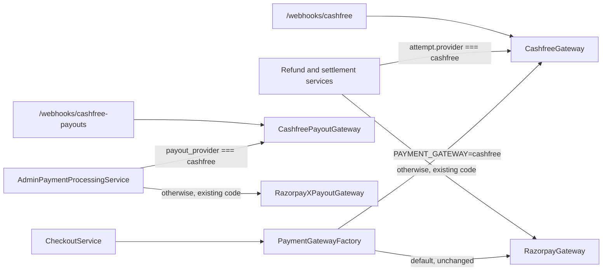
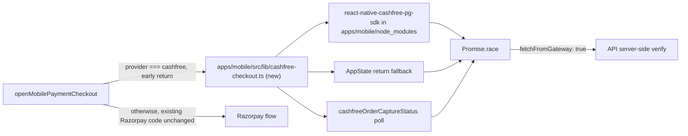

# Cashfree payment gateway for collections, refunds and payouts

## Goal

Add Cashfree as a second gateway for student collections (web and mobile), student refunds to the original payment method, and tutor bank payouts. Razorpay and RazorpayX keep working exactly as they do today, and `PAYMENT_GATEWAY=razorpay` / RazorpayX payouts remain the default until Cashfree is switched on.

## Ground rule: do not touch Razorpay

Razorpay (web, mobile, API, payouts) works in production. Cashfree is purely additive.

- Do not modify, refactor, rename, reorder or reformat existing Razorpay / RazorpayX code, DTO fields, GraphQL fields, database columns, env vars, secrets loading, webhooks, Metro config, autolinking config, native projects or package installs.
- Files that must stay unchanged: `RazorpayGateway` (in `payment-gateways.ts`), `razorpay-webhook.controller.ts`, `razorpayx-payout.gateway.ts`, `libs/shared-utils/src/payment-checkout.native.ts`, `apps/mobile/metro.config.js`, `apps/mobile/react-native.config.js`, the `react-native-razorpay` entries in the root and `apps/mobile` `package.json`, and the `razorpayOrderCaptureStatus` query.
- Where a shared service has to route Cashfree, add a guarded branch (`if (provider === 'cashfree') { ...new code... }`) in front of the existing code. The existing Razorpay statements below it are left exactly as they are, and anything that isn't Cashfree falls through to them.
- Check before merging: `git diff main` on the files above is empty. Existing Razorpay specs pass without edits. A Razorpay payment, refund and payout still work on staging and on mobile release builds.

## Current state

- `CashfreeGateway` in `apps/api/src/app/modules/payment/services/payment-gateways.ts` is a stub with only `createOrder` and `verifyPayment`. `verifyPayment` is broken because web checkout returns `paymentId = orderId`.
- Refunds, refund status, settlement lookups and the webhook call `RazorpayGateway` directly. `platform-fee-payment.service.ts` and `wallet-checkout.service.ts` use `instanceof RazorpayGateway` for the "fetch captured payment from gateway" path.
- Tutor payouts are hard-wired to `RazorpayXPayoutGateway`.
- Mobile `payment-checkout.native.ts` rejects any provider other than Razorpay.
- Mobile has duplicate React installs: the root pins `react@18.2.0` (via `overrides`, for web), while `apps/mobile/node_modules` has `react@19.0.0` / `react-native@0.79`. Razorpay mobile works because of workarounds in `metro.config.js` and `react-native.config.js`, plus a fallback race in `apps/mobile/src/lib/mobile-payment-checkout.ts`. Cashfree must be added so it never relies on, or changes, those workarounds (see section 7).
- `commerce_payment_attempt` already stores `provider` and `gateway_order_id`, which makes per-provider routing possible.

## Design

### 1. Gateway selection (API)

- `PaymentGatewayFactory` (`payment-gateway.factory.ts`): only add a new `getCashfreeGateway()` accessor. `getActiveGateway()` stays as it is; it already returns Cashfree when `PAYMENT_GATEWAY=cashfree`. Check this, and only change the Cashfree arm if it doesn't.
- `platform-fee-payment.service.ts` and `wallet-checkout.service.ts`: next to each `instanceof RazorpayGateway` check, add a separate `instanceof CashfreeGateway` branch that calls `CashfreeGateway.fetchCapturedPaymentForOrder`. The Razorpay checks themselves don't change.
- Don't change the shared `PaymentGateway` interface. New capabilities live on `CashfreeGateway` only.

### 2. Complete `CashfreeGateway` (PG API `x-api-version: 2023-08-01`)

- `createOrder`: generate a Cashfree-safe `order_id` (alphanumeric plus `_` and `-`, at most 45 characters) from the receipt. Send `order_meta.notify_url` pointing at `/api/webhooks/cashfree` and `order_meta.return_url` for redirect fallbacks. Include `order_tags` from the notes.
- `verifyPayment` / `fetchCapturedPaymentForOrder`: call `GET /pg/orders/{order_id}` and require `order_status === 'PAID'` with a matching amount. Then call `GET /pg/orders/{order_id}/payments` to pick the `SUCCESS` payment and return its `cf_payment_id`. Trust only the server-side lookup; ignore any client-supplied signature.
- `refundPayment`: `POST /pg/orders/{order_id}/refunds` with `refund_id` (our idempotency key, e.g. `cc-ref-{requestId}-{attemptId}`) and `refund_amount`. Reuse the dev-only `SIMULATED_GATEWAY_REFUND_PREFIX` behaviour.
- `fetchRefundStatus`: `GET /pg/orders/{order_id}/refunds/{refund_id}`. Return Cashfree's raw status (`SUCCESS`, `PENDING`, `ONHOLD`, `CANCELLED`, `FAILED`) and map it to "processed", "pending" or "failed" inside the Cashfree branches.
- `fetchSettlementForPayment`: `GET /pg/orders/{order_id}/settlements`, mapping `cf_settlement_id`, `settlement_utr` and the settled date.
- `verifyWebhookSignature(rawBody, timestamp, signature)`: base64 HMAC-SHA256 of `timestamp + rawBody` using `CASHFREE_SECRET_KEY`, compared in constant time.

### 3. Refund and settlement call sites (guarded branches only)

- `class-cancellation-refund-payout.service.ts`: in `refundThroughGateway` and the refund-status polling, add an `attempt.provider === 'cashfree'` branch that calls `CashfreeGateway` with `attempt.gatewayOrderId`. Everything else falls through to the existing Razorpay code unchanged.
- `admin-class-cancellation-refund.service.ts` and `admin-payment-processing.service.ts`: same approach. For Cashfree attempts, fill a new optional DTO field `cashfreeRefundStatus` and leave `razorpayRefundStatus` as it is. Existing GraphQL fields keep their names and meaning.
- `payment-settlement-batch.service.ts`: inside the per-attempt loop, add a Cashfree branch before the existing Razorpay call, so Cashfree attempts never reach `RazorpayGateway`.

### 4. Cashfree webhooks (new files)

- New `CashfreeWebhookController` at `POST /webhooks/cashfree`. In `apps/api/src/main.ts`, register raw-body handling for this route by adding a new line next to the Razorpay one; don't edit the Razorpay registration.
- Map `PAYMENT_SUCCESS_WEBHOOK` to `fulfillPaymentFromGateway(orderId, cfPaymentId)`, `PAYMENT_FAILED_WEBHOOK` and `PAYMENT_USER_DROPPED_WEBHOOK` to `markPendingPaymentFailed`, and `REFUND_STATUS_WEBHOOK` to a refresh of the linked refund request.
- Add a separate `POST /webhooks/cashfree-payouts` for Payouts V2 transfer events (`TRANSFER_SUCCESS`, `TRANSFER_FAILED`, `TRANSFER_REVERSED`), verified with the Payouts secret.

### 5. Cashfree Payouts for tutors (Payouts V2, `x-api-version: 2024-01-01`)

- New standalone `CashfreePayoutGateway` in `apps/api/src/app/modules/payment-processing/services/` with methods `isEnabled`, `ensureBeneficiaryForUser`, `createPayout` and `fetchPayout`. Don't extract an interface from `RazorpayXPayoutGateway` or change it.
  - `POST /payout/beneficiary` with `beneficiary_id = tutorix-user-{userId}`, bank account, IFSC and contact details.
  - `POST /payout/transfers` with `transfer_id = disb-{id}`, the amount in rupees and `transfer_mode: imps`.
  - `GET /payout/transfers?transfer_id=...` to sync status. Map `SUCCESS` to processed, `FAILED` and `REJECTED` to failed, `REVERSED` to reversed, and anything else to processing.
  - Auth: `x-client-id` / `x-client-secret`, plus an optional `x-cf-signature` (RSA-encrypted `clientId.timestamp` using `CASHFREE_PAYOUT_PUBLIC_KEY`) when IP whitelisting isn't used.
- `admin-payment-processing.service.ts`: when creating a payout, add a branch that uses `CashfreePayoutGateway` if `TUTOR_PAYOUT_PROVIDER=cashfree`, and record `payout_provider = 'cashfree'`. When syncing, rows with `payout_provider = 'cashfree'` go to Cashfree; all other rows, including `NULL`, go through the existing RazorpayX code.
- New migration with additive columns only: nullable `cashfree_beneficiary_id` on `user_bank_details` (cleared when bank details change, in the same place the Razorpay ids are cleared, without touching that code), and nullable `payout_provider` on `payment_disbursement`. No backfill: `NULL` means RazorpayX. Cashfree failures get their own message; the existing `RazorpayX payout ...` message stays.

### 6. Web checkout

- `libs/shared-utils/src/payment-checkout.ts`: change only the existing Cashfree branch. After `cashfree.checkout(...)` resolves, return `{ provider: 'cashfree', orderId, paymentId: '', signature: '', fetchFromGateway: true }`. Map `environment` to the SDK mode values (`sandbox` / `production`). The Razorpay branch stays as it is.

### 7. Mobile checkout (avoid the duplicate-React issue)

What went wrong with Razorpay: the root has React 18 and `apps/mobile` has React 19. Native SDK code imported from `libs/` resolved to the root copy, so the app ended up with two React / React Native instances and native events that never reached JS. That forced the Metro overrides and the fallback race. `react-native-cashfree-pg-sdk` (2.5.x) accepts any version (`react: '*'`, `react-native: '*'`), so npm won't warn about a mismatch. It also depends on `cashfree-pg-api-contract`, which provides the `CFSession` / `CFDropCheckoutPayment` classes and must resolve to the same single copy.

- **Install in `apps/mobile` only.** Run `npm install react-native-cashfree-pg-sdk` inside `apps/mobile`. Never add it to the root `package.json`.
  - Check that the only lockfile changes are new Cashfree entries: `react-native-razorpay` stays at `3.0.0` and `react` / `react-native` don't move.
  - Check there is exactly one copy of each package, under `apps/mobile/node_modules`:
    - `find . -path '*node_modules/react-native-cashfree-pg-sdk/package.json'`
    - `find . -path '*node_modules/cashfree-pg-api-contract/package.json'`
- **Import only from `apps/mobile/src`.** All Cashfree SDK imports live in a new `apps/mobile/src/lib/cashfree-checkout.ts`. When the SDK is imported from `apps/mobile/src`, Metro finds it in `apps/mobile/node_modules` first. The existing `resolveRequest` already sends `react` and `react-native` to the mobile copies. So no Metro or autolinking changes are needed. Don't import the Cashfree SDK anywhere under `libs/`, and don't edit `libs/shared-utils/src/payment-checkout.native.ts`.
- **Entry point.** In `apps/mobile/src/lib/mobile-payment-checkout.ts`, add one early return at the top of `openMobilePaymentCheckout`: `if (session.provider === 'cashfree') return openCashfreeMobileCheckout(session);`. The existing Razorpay helpers and race below it stay unchanged.
- **Checkout call.** `CFPaymentGatewayService.doWebCheckoutPayment(new CFDropCheckoutPayment(new CFSession(sessionId, orderId, env)))`, with `setCallback({ onVerify, onError })` wrapped in a promise. Call `removeCallback()` once the payment settles. Return `{ provider: 'cashfree', orderId, paymentId: '', signature: '', fetchFromGateway: true }`. Add a separate `__DEV__` guard in the new file that blocks `production` Cashfree sessions; don't modify `assertMobileRazorpayKeyAllowed`.
- **Don't rely on SDK callbacks alone.** The new module runs its own `Promise.race` of the SDK callback, an AppState-return fallback, and polling of a new `cashfreeOrderCaptureStatus(orderId)` query (a new resolver method and a new entry in `libs/shared-graphql/src/queries/payment.queries.ts`, backed by `CashfreeGateway.fetchCapturedPaymentForOrder`). Poll on both iOS and Android. `razorpayOrderCaptureStatus` isn't touched.
- **Native linking.** Autolinking picks the package up from `apps/mobile/package.json`. Run `pod install` (not `pod update`) and check that `Podfile.lock` only gains Cashfree pods. Run a Gradle sync and check that the Cashfree module path points into `apps/mobile/node_modules`.
- **Fallback only if verification fails.** If a check shows a root copy or a second React instance, fix it on the Cashfree side: remove the stray copy, or add new Cashfree-only lines to `metro.config.js` without editing the existing ones. If the native SDK still misbehaves, open Cashfree's hosted checkout in an in-app browser and confirm the payment on the server.
- **Test early.** Before building the rest of the mobile flow, run one sandbox Cashfree payment on real iOS and Android release builds (New Architecture on), and confirm that both `onVerify` and the poll fallback resolve.
- Requires a new native build for TestFlight / Play.

### 8. Config and secrets

- New env vars, documented in `.env.example`, `.env.docker.example`, `docker-compose.yml` and `docs/AWS_SECRETS_MANAGER.md`: `CASHFREE_APP_ID`, `CASHFREE_SECRET_KEY`, `CASHFREE_ENV`, `CASHFREE_PAYOUT_CLIENT_ID`, `CASHFREE_PAYOUT_CLIENT_SECRET`, `CASHFREE_PAYOUT_PUBLIC_KEY` (optional), `TUTOR_PAYOUT_PROVIDER` (defaults to `razorpayx` when unset).
- `app-secrets.loader.ts`: add new Cashfree handling (live keys applied from Secrets Manager only when `TUTORIX_ENV=production`; staging and dev use sandbox keys). Leave the Razorpay handling unchanged.
- Credentials go only into local `.env` and AWS Secrets Manager, never into the repo. In the Cashfree dashboard, register both webhook URLs, and for Payouts whitelist the staging and production server IPs unless you use the public key.
- Add a `cashfree` row to `payment_gateway_fee_config` (via the admin UI or a seed migration) so payout deductions use Cashfree's MDR. The `razorpay` row stays as it is.

### 9. Admin UI

- `PaymentProcessingPage.tsx` and `ClassCancellationsPage.tsx`: for Cashfree rows, show a provider badge and the new `cashfreeRefundStatus` / Cashfree payout id. Razorpay rows render exactly as they do today.

## Testing

- New unit specs: `CashfreeGateway` (order, verify, refund, refund status, settlement, webhook signature), `CashfreePayoutGateway`, the Cashfree branches in refund, settlement and payout services, the Cashfree web checkout branch, and `cashfree-checkout.ts` on mobile.
- Existing Razorpay and RazorpayX specs pass without being edited.
- Sandbox end-to-end on staging with `PAYMENT_GATEWAY=cashfree`, `CASHFREE_ENV=sandbox`: student cart checkout (web and mobile), registration fee, wallet top-up, cancellation refund to source, tutor payout, and webhook delivery for each.
- Mobile dependency checks: exactly one copy of `react-native-cashfree-pg-sdk` and `cashfree-pg-api-contract`; no Cashfree SDK import under `libs/`; no changes to `metro.config.js`, `react-native.config.js` or the Razorpay lock entries.
- Mobile release builds (iOS and Android, New Architecture): Cashfree success, user cancel and payment failure each resolve correctly.
- Razorpay regression (unchanged behaviour): with `PAYMENT_GATEWAY=razorpay`, web and mobile checkout, refund, settlement fetch and RazorpayX payout all work. A pre-existing Razorpay paid attempt can still be refunded after Cashfree is switched on.

## Implementation notes

Where the build differs from the plan above:

- **Settlements:** instead of a branch inside `payment-settlement-batch.service.ts`, a separate `CashfreeSettlementBatchService` and `CashfreeSettlementBatchCron` handle Cashfree attempts. They use the same `PAYMENT_SETTLEMENT_BATCH_*` flags and the `PAYMENT_SETTLEMENT_SYNC` job name with `metadata.provider = 'cashfree'`. The Razorpay batch and cron are unchanged; the Razorpay query already only picks up `provider = 'razorpay'`.
- **Beneficiaries:** the Cashfree beneficiary id is derived from the user id plus a hash of the account number and IFSC. A changed bank account therefore gets a new beneficiary automatically, and the bank-details service needs no change.
- **Payout logic:** lives in a new `CashfreeTutorPayoutService`. `AdminPaymentProcessingService` only delegates to it, and keeps its own transfer records without writing to `razorpay_payout_id`.
- **Failed-payment webhook:** `PAYMENT_FAILED_WEBHOOK` only marks the pending payment failed once Cashfree reports the order as closed (`EXPIRED` / `TERMINATED`), because students can retry inside the same checkout. `PAYMENT_USER_DROPPED_WEBHOOK` is ignored.
- **Mobile SDK call:** `react-native-cashfree-pg-sdk` 2.5.1 exposes `doWebPayment(CFSession)`, not `doWebCheckoutPayment`. The SDK is loaded lazily inside `openCashfreeMobileCheckout`. Returning to the app triggers a capture-status poll. If polling isn't available for the order type, the order is handed to the API to verify with `fetchFromGateway`.
- **Mobile install:** `npm install` inside `apps/mobile` re-resolves the whole tree, because `apps/mobile/package-lock.json` deliberately doesn't match `apps/mobile/package.json` (Agora, Netless and WebView are resolved from the root). Run that way, it pulled those packages and a nested React into `apps/mobile/node_modules`. The SDK was instead added surgically: verified tarballs extracted into `apps/mobile/node_modules`, and only the two Cashfree entries added to the lockfile. Do not run a plain `npm install` in `apps/mobile` to add or update packages.
- **Verified:** a Metro iOS bundle contains one copy each of `react`, `react-native`, `react-native-cashfree-pg-sdk` and `cashfree-pg-api-contract`, all from `apps/mobile/node_modules`. `pod install` only added Cashfree pods. `react-native config` links Cashfree on iOS and Android from `apps/mobile/node_modules`.

## Rollout

0. Mobile test: a Cashfree sandbox payment on iOS and Android release builds (see section 7) before building the rest of the mobile flow.
1. Merge with `PAYMENT_GATEWAY=razorpay` and `TUTOR_PAYOUT_PROVIDER` unset, so behaviour doesn't change.
2. Staging: switch both to Cashfree with sandbox keys and run the test matrix, including the Razorpay regression.
3. Production: load the live keys into Secrets Manager, register the webhooks, switch the flags, and ship the mobile build.
